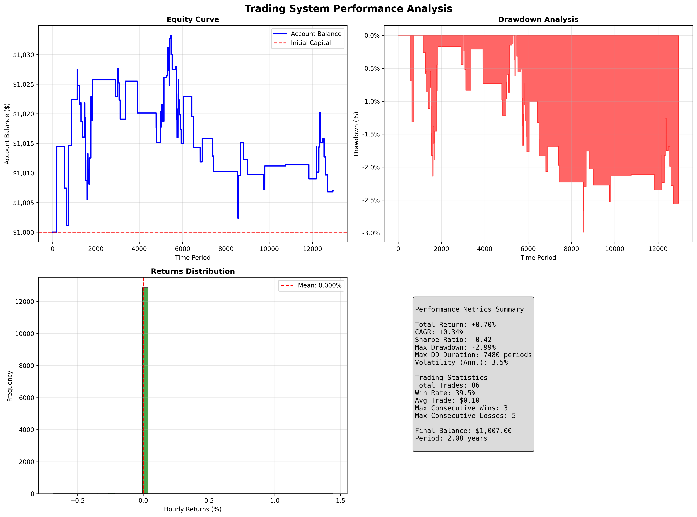
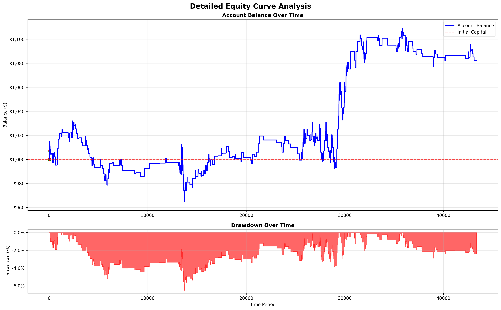

# EURUSD Price Forecasting and Backtesting System

A research project on short-horizon FX price forecasting with gradient-boosted trees, combined with a
transaction-cost-aware backtesting engine, random-search parameter optimization, and a MetaTrader 5
integration path.

The headline result is a negative one, and it is reported honestly: **the model does not produce a
tradable edge on EURUSD H1.** Its out-of-sample return is +0.70% over two years with a profit factor of
1.05, which is statistically and economically indistinguishable from zero. The project's value is in the
measurement infrastructure — a realistic backtester, a reproducible evaluation pipeline, and a clear
diagnosis of why the approach fails. Details are in [Results](#results) and
[Limitations](#limitations-and-methodology-notes).

---

## Results

Model: single XGBoost regressor predicting the next H1 close, with direction derived from the sign of
the predicted change. Data: EURUSD H1, 2018-01-02 to 2024-12-31 (43,504 bars), 70/30 chronological split.

| Metric | Value | Interpretation |
|---|---|---|
| Price R² (hold-out) | 0.9936 | Misleading — see below |
| Price R², naive persistence baseline | 0.9969 | **Baseline beats the model** |
| Directional accuracy (hold-out) | 49.81% | Statistically indistinguishable from chance |
| Up-bar base rate (hold-out) | 50.18% | The model is predicting the base rate |

R² on price *levels* is not a meaningful metric for a near-random-walk series: repeating the previous
close already scores 0.9969. The model's price forecast is marginally worse than doing nothing, and its
derived direction signal carries no information.

### Backtest

1.5 pip spread and 0.3 pip slippage, ATR-based stops, one position at a time, $1,000 initial capital.
Two configurations are reported, because the difference between them is the whole point.

| Metric | Full period, in-sample | Hold-out only, out-of-sample |
|---|---|---|
| Period | 2018-01-04 to 2024-12-31 | 2022-11-25 to 2024-12-31 |
| Total return | +8.24% | **+0.70%** |
| CAGR | +1.14% | +0.34% |
| Max drawdown | -6.52% | -2.99% |
| Trades | 376 | 86 |
| Win rate | 43.4% | 39.5% |
| Profit factor | 1.10 | 1.05 |
| Sharpe ratio | -0.07 | -0.42 |
| Buy-and-hold, same window | -13.10% | -0.08% |

The in-sample column looks respectable against a falling pair, but roughly 70% of that window is inside
the model's training data. Restricted to the hold-out period, the system returns +0.70% over two years
with a profit factor of 1.05 — economically zero. A profit factor of 1.05 across 86 trades is well
inside the range that random trading with a 2:1 target produces, and it does not survive financing
costs or any widening of the spread.

The negative Sharpe alongside a positive return is arithmetically correct rather than a contradiction:
the strategy is flat most of the time, so its mean hourly return does not clear the 2% annual risk-free
rate the metric subtracts. It is another way of saying the return is too small to distinguish from zero.

Parameter optimization was not re-run for this README. Its output is selection-biased by construction
(see limitation 5), so reporting an optimized column here would overstate the result.

For reference, buy-and-hold EURUSD over the full window returned -13.10% and over the hold-out window
-0.08%. The system's apparent advantage comes from being in the market only a small fraction of the
time — 376 trades across seven years of hourly bars — not from prediction skill.

Hold-out equity curve and drawdown:



Full-period equity curve:



---

## What is implemented

**Forecasting**
- 32 engineered features: SMAs and EMAs (5/10/20/50), price-to-MA ratios, MA crossovers, returns,
  rolling volatility, momentum, rate of change, Bollinger Bands and %B position, RSI, rolling highs
  and lows, distance from extremes.
- Sequence framing: 100 bars x 32 features flattened to a 3,200-dimension vector per sample.
- `Pipeline(StandardScaler -> XGBRegressor)`, GPU-accelerated via `device='cuda'` with CPU fallback.

**Backtesting engine**
- Spread and slippage modelled on entry; the round-trip cost is netted out of each trade's P&L.
- ATR-based dynamic stop loss (ATR x 2.0) and take profit (ATR x 4.0), giving a 2:1 target.
- Confidence-scaled position sizing, capped lot range, one open position at a time.
- Trailing stop that moves to break-even plus a buffer once a trade is 1.5R in profit.
- Signal filters: SMA(5)/SMA(20) trend alignment, volatility percentile ceiling, session-hours
  exclusion, and momentum confirmation.
- Metrics: total return, CAGR, Sharpe, max drawdown and duration, annualized volatility, win rate,
  profit factor, average win/loss, consecutive win/loss runs.
- Two Matplotlib report figures per run: performance dashboard and annotated equity curve.

**Optimization**
- Random sampling from a 1,280-point grid over ATR period, stop multiple, target multiple, confidence
  threshold, and position size.
- Objective is a weighted blend of total return, win rate, profit factor, and trade count, with a
  penalty for runs that produce fewer than 20 trades. Top-N parameter reporting and, in mode 3,
  validation of the best set on the full dataset.

  Note that the objective does **not** include a drawdown term, despite drawdown being the metric that
  matters most for this strategy. Adding one is an obvious improvement.

**Deployment path**
- MQL5 Expert Advisor that loads an ONNX export of the model and trades on the derived signal.
- `mt5_market_data.py` for pulling live rates from a MetaTrader 5 terminal.
- `merge_eurusd_data.py` for consolidating multi-year M1 archives into a single frame.

---

## Repository layout

```
.
├── backtest.py                                  # Backtesting engine and parameter optimizer
├── price_direction_random_forest_xgboost_model.py  # Feature engineering and model training
├── test_model.py                                # Hold-out evaluation and diagnostic plots
├── test_gpu.py                                  # CUDA / GPU availability check
├── merge_eurusd_data.py                         # M1 archive consolidation
├── mt5_market_data.py                           # MetaTrader 5 live data connection
├── random_forest_xgboost.mq5                    # MQL5 Expert Advisor (ONNX inference)
├── models/
│   ├── unified_price_regressor.pkl              # Trained Pipeline (scaler + XGBRegressor)
│   └── unified_price_model_info.json            # Feature list and recorded metrics
├── holdout_system_performance_analysis.png      # Out-of-sample results dashboard
├── holdout_system_equity_curve.png              # Out-of-sample equity curve
├── default_system_performance_analysis.png      # Full-period results dashboard
├── default_system_equity_curve.png              # Full-period equity curve
├── requirements.txt
└── README.md
```

Data files are not committed. See [Setup](#setup) for expected formats.

---

## Setup

```bash
python -m venv .venv
source .venv/bin/activate        # Windows: .venv\Scripts\activate
pip install -r requirements.txt
```

GPU training requires a CUDA-enabled XGBoost build. The code falls back to CPU if CUDA is unavailable.

### Data

Place the EURUSD H1 export in the repository root as
`EURUSDm_H1_201801020600_202412310000.csv`. The expected format is a tab-separated MetaTrader export
with the header `<DATE> <TIME> <OPEN> <HIGH> <LOW> <CLOSE> <TICKVOL> <VOL> <SPREAD>`.

---

## Usage

Train the model (writes `models/unified_price_regressor.pkl` and regenerates the performance figure):

```bash
python price_direction_random_forest_xgboost_model.py
```

Run a hold-out evaluation of a trained model:

```bash
python test_model.py
```

Note that `test_model.py` runs on **synthetic data** — it is a smoke test that the model loads and
produces internally consistent output, not a performance measurement. The real hold-out metrics are in
`models/unified_price_model_info.json` and reproduced in [Results](#results).

Run the backtester. The script prompts for a mode:

1. Quick test with default parameters (full dataset, several minutes)
2. Parameter optimization only (12-month subset, 30-60 min)
3. Optimization followed by full-dataset validation (60-90 min)

```bash
python backtest.py
```

Programmatic use:

```python
import pandas as pd
from backtest import Backtester

# DataFrame indexed by timestamp, with a 'close' column (other columns optional)
raw = pd.read_csv('EURUSDm_H1_201801020600_202412310000.csv', sep='\t')
raw['time'] = pd.to_datetime(raw['<DATE>'] + ' ' + raw['<TIME>'], format='%Y.%m.%d %H:%M:%S')
data = pd.DataFrame({'close': pd.to_numeric(raw['<CLOSE>'], errors='coerce')},
                    index=raw['time']).dropna()

bt = Backtester(model_path='models/unified_price_regressor.pkl', initial_capital=1000)
bt.atr_stop_multiplier = 2.5
bt.min_confidence = 0.002
final_balance, trade_count = bt.run_backtest(data, n_steps=100)
```

Check GPU availability:

```bash
python test_gpu.py
```

---

## Limitations and methodology notes

These are known issues, documented deliberately. They are the most useful part of the project and the
starting point for any further work.

1. **The default backtest is not out-of-sample.** `Backtester.run_backtest` iterates from bar 100 of the
   full dataset, which places roughly 70% of the evaluated period inside the model's training window.
   The full-period column above is therefore in-sample and optimistic. Pass `start_date` to restrict the
   run to the hold-out split (from 2022-11-25 onward), which is how the out-of-sample column was
   produced; a walk-forward retraining loop would be the more rigorous fix.

2. **R² on price levels is not a valid metric.** As shown above, a persistence forecast scores 0.9969
   against the model's 0.9936. Evaluation should target the quantity being traded — the sign or
   magnitude of the next return — not the price level.

3. **ATR uses synthesized highs and lows.** The data loader reads only the close column, so
   `calculate_atr` fabricates high/low as close +/- 0.5 sigma of a 5-bar rolling standard deviation,
   even though true OHLC is present in the source file. This compresses the volatility estimate and
   therefore distorts stop and target distances. The fix is to load and use the real high/low columns.

4. **Directional accuracy is at chance.** 49.81% against a 50.18% base rate. No amount of parameter
   tuning in the backtest layer can fix an uninformative signal; the system's small positive return
   reflects reduced market exposure and the 2:1 target geometry, not improved prediction.

5. **Parameter selection and validation use overlapping data.** The optimizer tunes on the trailing 12
   months and then validates on the full history, which includes that same 12 months. Best-parameter
   results are selection-biased. This is why no optimized column is reported above.

6. **Single-asset, single-regime sample.** One currency pair over seven years. EURUSD was range-bound
   for much of this period; results should not be generalized.

7. **Model artifacts are committed.** `models/unified_price_regressor.pkl` is a binary that requires a
   matching scikit-learn and XGBoost version to load. Production use would pin versions and re-export.

8. **Results are sensitive to cost assumptions.** Spread and slippage are fixed constants rather than
   modelled from the `<SPREAD>` column present in the source data. With a profit factor of 1.05, the
   conclusion flips to a loss under only a modest widening of the spread.

### Fixed during cleanup

The following defects were found and corrected while preparing this repository:

- **Transaction costs were charged twice.** `calculate_trade_pnl` nets the cost out of each trade's
  P&L, and the backtest loop *also* deducted it from the balance at entry. Every trade was therefore
  billed twice, which understated returns. The full-period result changed from -0.54% to +8.24% once
  the duplicate deduction was removed. Any earlier figure in this project's history predates that fix.
- **A plotting bug** passed integer bar positions where a datetime axis was expected, producing a
  spurious 1970–2020 x-axis on the evaluation charts.
- **Emoji in console output** raised `UnicodeEncodeError` on Windows cp1252 terminals, crashing the
  scripts before they printed results.
- **A hardcoded personal path** in `merge_eurusd_data.py` was replaced with the `EURUSD_M1_DIR`
  environment variable.
- **The optimization grid was documented as 1,600 combinations**; it is 4x4x4x5x4 = 1,280.
- **`test_model.py` reported synthetic-data accuracy as if it were a result.** It evaluates on
  `generate_realistic_sample_data()`, a random walk with an embedded upward trend and a 60% up-bar base
  rate, over 30 usable samples. Its "63.3%, better than random" banner was measuring the trend, not the
  model. The script now prints the majority-class base rate alongside accuracy and states that it is a
  smoke test only.

---

## Next steps

- [ ] Restrict backtesting to the hold-out window by default; add a walk-forward retraining loop.
- [ ] Load real OHLC and compute ATR from true ranges.
- [ ] Re-target the learning problem: predict return sign or binned return magnitude, and evaluate
      with log loss, Brier score, and directional accuracy against a base-rate baseline.
- [ ] Add a null-hypothesis test for directional accuracy (binomial test) so improvements are
      distinguishable from noise.
- [ ] Run a permutation or shuffled-label control to confirm the model learns nothing exploitable.
- [ ] Model costs explicitly in the objective function rather than only in the simulator.
- [ ] Extend to multiple pairs for cross-sectional validation.

---

## Technical notes

**Feature set (32):** `sma_5, sma_10, sma_20, sma_50, ema_5, ema_10, ema_20, price_vs_sma5,
price_vs_sma10, price_vs_sma20, sma5_vs_sma10, sma10_vs_sma20, returns, volatility_5, volatility_10,
volatility_20, momentum_3, momentum_5, momentum_10, roc_5, roc_10, bb_middle, bb_upper, bb_lower,
bb_position, rsi, high_5, low_5, high_10, low_10, dist_from_high5, dist_from_low5`

**Model configuration:** `objective=reg:squarederror`, `n_estimators=150`, `max_depth=8`,
`learning_rate=0.1`, `subsample=0.8`, `colsample_bytree=0.8`, `tree_method=hist`, `device=cuda`,
`random_state=42`.

**Optimization grid (1,280 combinations):**

```python
parameter_space = {
    'atr_period':            [10, 14, 20, 25],
    'atr_stop_multiplier':   [1.5, 2.0, 2.5, 3.0],
    'atr_profit_multiplier': [3.0, 4.0, 5.0, 6.0],
    'min_confidence':        [0.001, 0.0015, 0.002, 0.0025, 0.003],
    'max_position_size':     [0.001, 0.002, 0.003, 0.005],
}
```

---

## Disclaimer

This is a research and software engineering exercise, not a trading system. It is not profitable in any
economically meaningful sense, has never been run with real capital, and its out-of-sample return is
indistinguishable from zero. Nothing here is financial advice. Past backtest performance is not
indicative of future results, and a strategy with a profit factor barely above 1.0 will lose money in
live trading once financing and execution friction are included.
